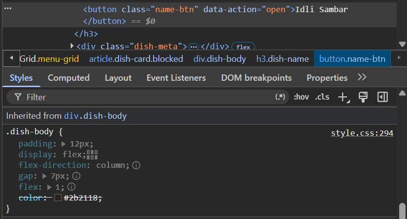

# Debug log

# Bugs
## CC-01 : "The search suggestions are behind everything"

**Reproduced:** The issue with the matching search items hidden behind the rest of the page, typing anything does not show the correct results.

**Cause:** Most definitely a small enough z-index which causes the elements of the search bar to render behind the other sections which have a higher z-index.

**Fix:** Set the z-index in [style.css](./frontend/style.css#L758) to an arbitrarily high value so the search bar elements render in front always.

**Checked:** Search bar displays the matched results properly now.

**Time:** About 1 minute. Such issues are almost always correspond to lower z-index values.

---

## CC-02: "Can't read anything in dark mode"

**Reproduced:** The name and price of the dish are not visible in dark mode on the dish cards.

**Cause:** The issue was because of a hard coded hex which did not inherit the value from the parent element, causing the title and the prices to be rendered in a dark toned colour irrespective of the theme. This was identified by following the inheritance trace of the `color` property on the `name-btn` class:

**Fix:** The issue was fixed by changing the `color` in [styles.css](./frontend/style.css#L295) property to inherit the parent elements style so the theme specific hex is respected.

**Checked:** The names and the price are properly displayed.

**Time:** About 2 minutes. Followed the style traces in dev tools.

---

## CC-09: "The menu shows more dishes than it should"

**Reproduced:** The menu page showed all 37 available dishes by default, contrary to the expected step loading behaviour.

**Cause:** The issue was caused because the [`paginate`](./backend/logic/search.js#L94) function returned the provided list of items as-is without any modifications.

**Fix:** The issue was fixed by simply returning the slicd list of items instead of the entire list as is.

**Checked:** The issue is now fixed with 5 dishes shown by default, adding 5 more on each scroll.

**Time:** About 5 minutes.

---

# Extra credit
## Unreported Bugs
## CC-U1: Price Filter on Menu Page shows Incosistent Results
TODO: add data here (issue fixed in previous commit)

**Reproduced:** 

**Cause:**

**Fix:**

**Checked:**

**Time:**

## CC-U2: Orders page does not show orders
TODO: add data (issue fixed in current commit)